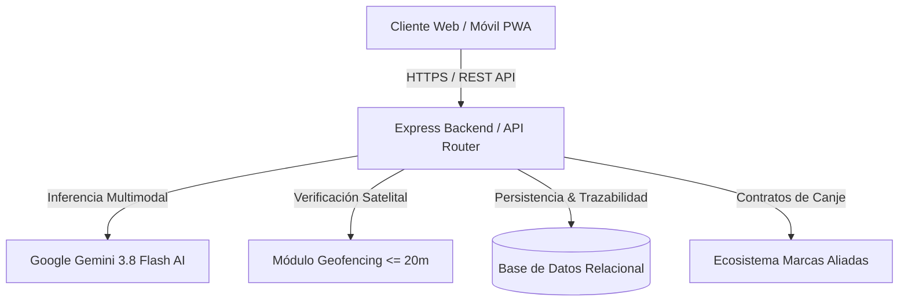
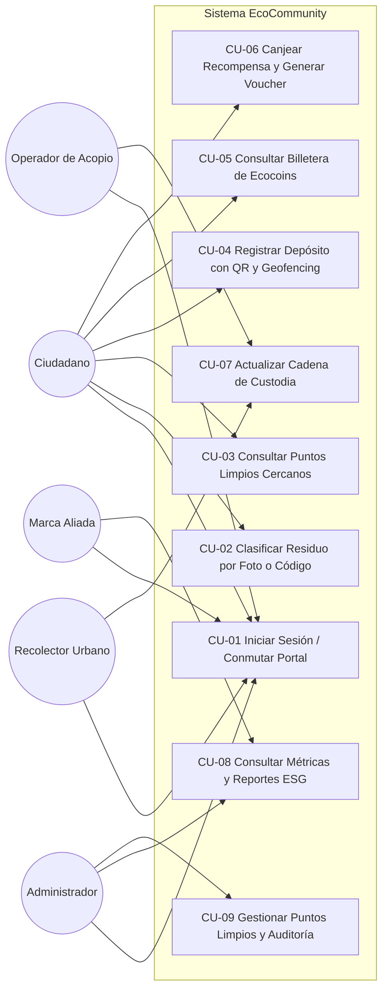

# ESPECIFICACIÓN DE REQUISITOS DE SOFTWARE (SRS)

**Multiplataforma Digital Inteligente de Reciclaje Ciudadano, Trazabilidad ESG y Economía Circular**  
**ECOCOMMUNITY**

---

**Integrantes del Proyecto:**  
- [POR CONFIRMAR: Nombre del Aprendiz 1 / Rol Líder de Proyecto]  
- [POR CONFIRMAR: Nombre del Aprendiz 2 / Analista y Desarrollador]  
- [POR CONFIRMAR: Nombre del Aprendiz 3 / Diseñador UI/UX y QA Tester]  
- [POR CONFIRMAR: Nombre del Aprendiz 4 / Desarrollador Full-Stack]  

**Centro de Formación:** SENA – Centro de la Industria, la Empresa y los Servicios / [POR CONFIRMAR: Regional]  
**Programa:** Tecnólogo en Análisis y Desarrollo de Software (ADSO)  
**Fecha de Consolidación:** 13/11/2026  
**Versión:** 1.0 (Versión consolidada y alineada a la arquitectura y código base)

---

## Tabla de contenido

- [1. Introducción](#1-introducción)
  - [1.1. Planteamiento del Problema](#11-planteamiento-del-problema)
  - [1.2. Propósito del proyecto](#12-propósito-del-proyecto)
  - [1.3. Justificación](#13-justificación)
  - [1.4. Objetivo General](#14-objetivo-general)
    - [1.4.1. Objetivos Específicos](#141-objetivos-específicos)
  - [1.5. Alcances](#15-alcances)
  - [1.6. Personal Involucrado](#16-personal-involucrado)
  - [1.7. Definiciones, Acrónimos y Abreviaturas](#17-definiciones-acrónimos-y-abreviaturas)
  - [1.8. Referencias](#18-referencias)
  - [1.9. Resumen del Proyecto](#19-resumen-del-proyecto)
- [2. Descripción General](#2-descripción-general)
  - [2.1. Perspectiva del Producto](#21-perspectiva-del-producto)
  - [2.2. Características de los Usuarios](#22-características-de-los-usuarios)
  - [2.3. Restricciones](#23-restricciones)
  - [2.4. Suposiciones y Dependencias](#24-suposiciones-y-dependencias)
- [3. Requisitos Específicos](#3-requisitos-específicos)
  - [3.1. Requisitos comunes de las interfaces](#31-requisitos-comunes-de-las-interfaces)
    - [3.1.1. Interfaces de usuario](#311-interfaces-de-usuario)
    - [3.1.2. Interfaces de hardware](#312-interfaces-de-hardware)
    - [3.1.3. Interfaces de software](#313-interfaces-de-software)
    - [3.1.4. Interfaces de comunicación](#314-interfaces-de-comunicación)
  - [3.2. Historias de usuario](#32-historias-de-usuario)
  - [3.3. Requerimientos Funcionales](#33-requerimientos-funcionales)
    - [3.3.1. Módulo de Autenticación, Usuarios y Portales Privados](#331-módulo-de-autenticación-usuarios-y-portales-privados)
    - [3.3.2. Módulo de Clasificación Inteligente de Residuos (IA Gemini y Código de Barras)](#332-módulo-de-clasificación-inteligente-de-residuos-ia-gemini-y-código-de-barras)
    - [3.3.3. Módulo de Puntos Limpios, Geolocalización y Geofencing](#333-módulo-de-puntos-limpios-geolocalización-y-geofencing)
    - [3.3.4. Módulo de Depósito Seguro, Validación QR y Control Antifraude](#334-módulo-de-depósito-seguro-validación-qr-y-control-antifraude)
    - [3.3.5. Módulo de Billetera de Ecocoins, Métricas de Impacto y Canje de Recompensas](#335-módulo-de-billetera-de-ecocoins-métricas-de-impacto-y-canje-de-recompensas)
    - [3.3.6. Módulo de Trazabilidad ESG, Cadena de Custodia y Reportes de Circularidad](#336-módulo-de-trazabilidad-esg-cadena-de-custodia-y-reportes-de-circularidad)
    - [3.3.7. Módulo de Resiliencia Fuera de Línea (Offline-First y Sincronización)](#337-módulo-de-resiliencia-fuera-de-línea-offline-first-y-sincronización)
    - [3.3.8. Módulo de Administración y Auditoría del Sistema](#338-módulo-de-administración-y-auditoría-del-sistema)
  - [3.4. Requerimientos No Funcionales](#34-requerimientos-no-funcionales)
- [4. Requisitos de casos de uso](#4-requisitos-de-casos-de-uso)
  - [4.1. Diagrama UML de Casos de Uso](#41-diagrama-uml-de-casos-de-uso)
  - [4.2. Caracterización de Casos de Uso](#42-caracterización-de-casos-de-uso)
    - [4.2.1. Casos de uso en funcionalidades](#421-casos-de-uso-en-funcionalidades)
- [5. Modelo conceptual consolidado y corregido](#5-modelo-conceptual-consolidado-y-corregido)
  - [5.1. Decisiones de corrección del modelo](#51-decisiones-de-corrección-del-modelo)
  - [5.2. Entidades y atributos de referencia](#52-entidades-y-atributos-de-referencia)
  - [5.3. Relaciones y cardinalidades consolidadas](#53-relaciones-y-cardinalidades-consolidadas)
  - [5.4. Reglas de negocio consolidadas](#54-reglas-de-negocio-consolidadas)
- [6. Dominios y microservicios propuestos](#6-dominios-y-microservicios-propuestos)
  - [6.1. Funciones administrativas y transversales](#61-funciones-administrativas-y-transversales)
  - [6.2. Integración entre microservicios](#62-integración-entre-microservicios)
- [7. Patrones de arquitectura y diseño](#7-patrones-de-arquitectura-y-diseño)
  - [7.1. Arquitectura objetivo simplificada](#71-arquitectura-objetivo-simplificada)
- [8. Alcance consolidado y límites del proyecto](#8-alcance-consolidado-y-límites-del-proyecto)
- [9. Fuente de verdad para trabajos posteriores](#9-fuente-de-verdad-para-trabajos-posteriores)

---

## 1. Introducción

El presente documento constituye la Especificación de Requisitos de Software (SRS) de la multiplataforma **EcoCommunity**, desarrollada bajo las directrices del programa de formación Tecnólogo en Análisis y Desarrollo de Software del SENA y alineada con las recomendaciones de la norma IEEE 830.

### 1.1. Planteamiento del Problema
La gestión de residuos sólidos urbanos y la transición hacia una economía circular en Colombia enfrentan barreras críticas:
1. **Falta de cultura e incertidumbre en la separación en la fuente:** El ciudadano desconoce con frecuencia la reciclabilidad efectiva de un empaque (plásticos multicapa vs. PET, cartón contaminado, etc.) y las instrucciones correctas de limpieza y compactación.
2. **Desconexión física y logística:** Los puntos limpios, contenedores inteligentes y centros de acopio suelen estar desarticulados de las rutas ciudadanas cotidianas, sin información de horarios, materiales aceptados ni niveles de saturación en tiempo real.
3. **Ausencia de incentivos tangibles e inmediatos:** La separación de residuos exige esfuerzo ciudadano sin que exista un retorno percibido, lo que desmotiva el hábito sostenido.
4. **Vulnerabilidad al fraude en esquemas de recompensa:** Los sistemas basados en autoreporte sufren de registros duplicados o falsas entregas al no contar con verificación de proximidad física ni validación de contenedores.
5. **Ruptura de la cadena de custodia y falta de métricas ESG auditables:** Las empresas generadoras y marcas aliadas carecen de datos verificables sobre el destino final de sus empaques posconsumo para cumplir la normativa ambiental vigente (Resolución 1407 de 2018 / Directiva de Responsabilidad Extendida del Productor - REP).

### 1.2. Propósito del proyecto
El propósito de **EcoCommunity** es proveer una plataforma tecnológica integral (Web responsiva y arquitectura orientada a servicios móviles) que articule a la ciudadanía, los recicladores de oficio, los puntos de acopio y las marcas aliadas mediante:
- Clasificación visual asistida por Inteligencia Artificial (IA Gemini Multimodal) y lectura de códigos de barras.
- Geolocalización con validación estricta de cercanía perimetral (*geofencing* a un radio máximo de 20 metros) y lectura de códigos QR únicos por contenedor.
- Gamificación y economía circular mediante la billetera de **Ecocoins**, canjeables por cupones y beneficios comerciales reales.
- Trazabilidad y cadena de custodia con recibos digitales respaldados criptográficamente para reportes de cumplimiento ESG.

### 1.3. Justificación
Frente a los mecanismos tradicionales de recolección, **EcoCommunity** unifica la pedagogía ecológica inmediata mediante visión artificial, la verificación física antifraude y la compensación monetizable. Esto transforma al ciudadano en un agente activo de la economía circular, dignifica y optimiza la labor de los recicladores urbanos, y ofrece a las marcas aliadas un canal transparente para cumplir con sus compromisos de sostenibilidad y neutralidad de empaques.

### 1.4. Objetivo General
Desarrollar una multiplataforma digital inteligente de intermediación, clasificación y trazabilidad de reciclaje ciudadano denominada **EcoCommunity**, integrando tecnologías web modernas, modelos de visión artificial, georreferenciación y gestión de transacciones de incentivos ecológicos para fomentar la economía circular y la rendición de cuentas ambiental.

#### 1.4.1. Objetivos Específicos
1. Analizar los flujos operativos de reciclaje urbano, identificando actores (ciudadanos, recolectores, acopios, marcas y administradores), reglas de negocio y restricciones antifraude.
2. Diseñar la arquitectura por capas, el modelo conceptual relacional, los contratos de API RESTful y las interfaces de usuario especializadas por portal.
3. Construir el motor de clasificación híbrida de residuos utilizando el SDK de Google GenAI (`gemini-3.8-flash`) y un catálogo de lectura de códigos de barras con directrices de preparación de materiales.
4. Implementar el módulo de geolocalización, cálculo de distancias (fórmula de Haversine) y validación perimetral (*geofencing* $\le 20$ metros) sincronizado con códigos QR por estación física.
5. Desarrollar la billetera virtual de **Ecocoins**, gestionando la acumulación por peso/material y el canje controlado de vouchers en comercios aliados.
6. Construir el módulo de trazabilidad y cadena de custodia ESG con generación de recibos digitales indexados por hash criptográfico y reportes de ahorro de $CO_2$ y agua.
7. Proveer capacidades de tolerancia a fallos (*Offline-First*) mediante cola local en el cliente para zonas de baja conectividad.
8. Validar el sistema mediante pruebas funcionales, de seguridad, usabilidad y rendimiento.

### 1.5. Alcances
El desarrollo se estructura en tres etapas incrementales:

- **Etapa 1 – MVP Operativo:**
  - Autenticación y roles de usuario (Ciudadano, Recolector, Centro de Acopio, Marca Aliada, Admin).
  - Escáner y clasificación por IA Gemini Vision y catálogo de código de barras.
  - Directorio y mapa de Puntos Limpios con cálculo de distancia y geofencing ($\le 20$ m).
  - Depósito seguro con lectura de QR y control antifraude básico (cooldown 24h).
  - Billetera de Ecocoins (abono de puntos y métricas de $CO_2$ y kg reciclados).
  - Catálogo de recompensas y generación de voucher digital.
  - Recibo digital con hash de entrega.

- **Etapa 2 – Optimización e Integración Operativa:**
  - Portales privados avanzados para Recolectores Urbanos y Puntos de Acopio (pesaje industrial y actualización de cadena de custodia).
  - Portal de Marcas Aliadas para autogestión de stock de recompensas e impacto de marca.
  - Modo fuera de línea (*Offline-First*) con sincronización de depósitos al reconectar.
  - Auditoría administrativa avanzada y bloqueo de cuentas por infracciones.

- **Etapa 3 – Expansión y Escalabilidad:**
  - Aplicación móvil nativa Android con integración de sensores de hardware (cámara y GPS nativo).
  - Integración telemática con sensores IoT de nivel de llenado de contenedores en tiempo real.
  - Integración con pasarelas de pago o transferencias directas de saldo de billetera [POR CONFIRMAR].
  - Certificación de bonos de carbono bajo estándares internacionales [POR CONFIRMAR].

### 1.6. Personal Involucrado

| Nombre Completo | Cargo / Función | Categoría profesional | Responsabilidades | Datos de contacto |
| :--- | :--- | :--- | :--- | :--- |
| [POR CONFIRMAR: Instructor Asignado] | Instructor Técnico | Ingeniero de Sistemas | Supervisión técnica y metodológica del proyecto formativo. | [POR CONFIRMAR: Correo SENA] |
| [POR CONFIRMAR: Aprendiz 1] | Líder de Proyecto y Analista de Requisitos | Aprendiz Tecnólogo ADSO | Coordinación general, especificación del SRS, diseño de reglas de negocio y control de entregables. | [POR CONFIRMAR: Correo electrónico] |
| [POR CONFIRMAR: Aprendiz 2] | Analista y Diseñador de Software | Aprendiz Tecnólogo ADSO | Modelado conceptual de datos, diseño de diagramas UML, casos de uso y diseño de base de datos. | [POR CONFIRMAR: Correo electrónico] |
| [POR CONFIRMAR: Aprendiz 3] | Diseñadora UI/UX y QA Tester | Aprendiz Tecnólogo ADSO | Diseño de prototipos, paleta de colores accesible, pruebas funcionales y validación de usabilidad. | [POR CONFIRMAR: Correo electrónico] |
| [POR CONFIRMAR: Aprendiz 4] | Desarrollador Full-Stack Principal | Aprendiz Tecnólogo ADSO | Implementación de frontend (React/Vite), backend (Node/Express), integración con Gemini API y APIs REST. | [POR CONFIRMAR: Correo electrónico] |

### 1.7. Definiciones, Acrónimos y Abreviaturas

| Término / Acrónimo | Definición |
| :--- | :--- |
| **Punto Limpio / Hub** | Instalación fija o contenedor automatizado donde se reciben residuos clasificados. |
| **Geofencing** | Perímetro geográfico virtual que restringe la ejecución de un depósito a un radio máximo de 20 metros. |
| **Haversine** | Ecuación trigonométrica para calcular la distancia ortodrómica entre dos puntos sobre una esfera a partir de sus coordenadas GPS. |
| **Ecocoins** | Puntos de fidelidad digital acreditados al usuario por cada entrega válida de residuos. |
| **Gemini Vision AI** | Modelo multimodal de inteligencia artificial (`gemini-3.8-flash`) utilizado para identificar materiales en imágenes. |
| **Cadena de Custodia** | Trazabilidad del residuo a través de los estados: *depositado*, *recolectado*, *en_acopio* y *transformado*. |
| **ESG** | Criterios Ambientales, Sociales y de Gobernanza (*Environmental, Social, and Governance*). |
| **Hash Digital** | Cadena alfanumérica única generada para garantizar la inmutabilidad de cada recibo de depósito. |
| **Offline-First** | Estrategia de diseño que almacena acciones en caché local cuando no hay conexión a internet y las procesa al restaurarse. |
| **PET** | Polietileno Tereftalato, plástico reciclable comúnmente usado en botellas de bebidas. |
| **Voucher** | Cupón digital alfanumérico generado al canjear Ecocoins para su redención en marcas aliadas. |

### 1.8. Referencias
- **Congreso de la República de Colombia.** Ley 1581 de 2012. *Régimen General de Protección de Datos Personales (Habeas Data).*
- **Ministerio de Ambiente y Desarrollo Sostenible (MADS).** Resolución 1407 de 2018. *Gestión ambiental de residuos de envases y empaques.*
- **Ministerio de Ambiente y Desarrollo Sostenible (MADS).** Resolución 2184 de 2019. *Código unificado de colores para la separación de residuos en la fuente.*
- **IEEE Computer Society.** IEEE Std 830-1998. *IEEE Recommended Practice for Software Requirements Specifications.*
- **Google Cloud.** Gemini API Documentation (`@google/genai` SDK v2.4+). *Multimodal structured outputs and JSON Schema generation.*
- **DANE.** (2026). *Encuesta de Calidad de Vida e Indicadores Ambientales y de Sostenibilidad Urbana.*

### 1.9. Resumen del Proyecto
**EcoCommunity** es un ecosistema multiplataforma (Web React + API Express + Arquitectura adaptable a Android) que promueve la economía circular mediante incentivos auditables. La plataforma combina la clasificación asistida por Inteligencia Artificial y códigos de barras con mecanismos antifraude basados en geofencing satelital y códigos QR físicos. Cada depósito genera un recibo digital verificable y acredita **Ecocoins** en una billetera comunitaria, alimentando simultáneamente tableros ESG que miden kg reciclados, ahorro de $CO_2$ y equivalencia en árboles conservados.

---

## 2. Descripción General

### 2.1. Perspectiva del Producto
EcoCommunity es un sistema independiente y centralizado que opera bajo una arquitectura cliente-servidor enriquecida con capacidades de inferencia en la nube (Google Gemini AI) y almacenamiento relacional estructurado. La solución expone servicios RESTful consumibles tanto por portales web especializados como por clientes móviles, ofreciendo una experiencia responsiva con soporte sin conexión.



### 2.2. Características de los Usuarios
1. **Ciudadano:** Usuario que clasifica sus empaques, ubica contenedores en el mapa, realiza depósitos físicos, acumula Ecocoins y canjea cupones. Posee conocimientos básicos de navegación web en smartphones.
2. **Recolector Urbano:** Trabajador u operario de ruta que retira residuos de los contenedores inteligentes, valida pesajes en terreno y actualiza la cadena de custodia al estado *recolectado*.
3. **Punto de Acopio / Operador de Centro Limpio:** Administrador del centro físico que recepciona el volumen consolidado, valida el estado del material y cambia el estado a *en_acopio* o *transformado*.
4. **Marca Aliada (Patrocinador ESG):** Empresa vinculada que provee recompensas, financia incentivos ecológicos y consulta métricas certificadas de recuperación de sus empaques para cumplimiento normativo.
5. **Administrador del Sistema:** Personal técnico y operativo encargado de registrar puntos limpios, gestionar el catálogo de materiales, auditar transacciones sospechosas y supervisar el balance de Ecocoins.

### 2.3. Restricciones
- La funcionalidad de cámara y GPS en el cliente requiere consentimiento explícito de permisos del navegador o sistema operativo.
- El depósito válido exige una distancia geodésica máxima de 20 metros respecto a las coordenadas maestras del punto limpio registrado.
- Política antifraude: un usuario no puede registrar más de una entrega del mismo material en el mismo punto de acopio dentro de una ventana de 24 horas.
- Cumplimiento de la Ley 1581 de 2012 para el tratamiento de datos de contacto y georreferenciación de usuarios.
- Tamaño máximo de imagen capturada para análisis multimodal: 20 MB en formato Base64 (JPEG, PNG o WebP).

### 2.4. Suposiciones y Dependencias
- **Suposiciones:**
  - Los dispositivos clientes disponen de cámara funcional y receptor GPS para realizar depósitos.
  - Los contenedores físicos portan un código QR adhesivo legible y resistente al intemperismo.
  - Las marcas aliadas honran los códigos de voucher emitidos por la plataforma en sus puntos de venta.
- **Dependencias:**
  - Disponibilidad del servicio de la API de Google Gemini (`gemini-3.8-flash`) con fallback local heurístico ante cortes de red.
  - Conectividad a Internet en el servidor backend para el procesamiento transaccional en tiempo real.
  - Sistema de geolocalización satelital del navegador/dispositivo del usuario.

---

## 3. Requisitos Específicos

### 3.1. Requisitos comunes de las interfaces

#### 3.1.1. Interfaces de usuario
- Diseño limpio y adaptable basado en Tailwind CSS, optimizado para interacción táctil en pantallas móviles y monitores de escritorio.
- Navegación inferior persistente (*Bottom Navigation Bar*) en vista móvil para acceso rápido a: Escáner, Mapa, Billetera/Premios y Reportes ESG.
- Modales contextuales claros con confirmación de depósito, recibo digital con código hash y vista de voucher de canje con código QR.
- Indicador visual persistente de conectividad (Banner "Modo Fuera de Línea") que alerta cuando las acciones se guardan en cola local.
- Paleta cromática con contraste accesible (verde esmeralda, gris pizarra y fondos claros) alineada con temáticas ecológicas.

#### 3.1.2. Interfaces de hardware
- Cámara integrada en smartphones o computadores portátiles con resolución mínima de 720p para captura de empaques y lectura de códigos de barras/QR.
- Módulo GPS / GNSS del dispositivo cliente capaz de emitir coordenadas de latitud y longitud con una precisión mínima de $\pm 10$ metros.
- Servidor de alojamiento con procesador mínimo de 2 núcleos x86_64, 4 GB de RAM y almacenamiento en disco sólido (SSD).

#### 3.1.3. Interfaces de software
- **Frontend:** React 19, TypeScript, Vite, Tailwind CSS, Lucide React Icons, Canvas Confetti.
- **Backend:** Node.js (v22+), Express 4, TypeScript (`tsx`).
- **SDK de IA:** `@google/genai` (SDK oficial de Google Cloud para Gemini API).
- **Almacenamiento del cliente:** Web Storage API (`localStorage`) para colas offline y persistencia de sesión.
- **Navegadores soportados:** Google Chrome (v110+), Mozilla Firefox (v115+), Microsoft Edge (v110+), Safari (v16+).

#### 3.1.4. Interfaces de comunicación
- Protocolo seguro **HTTPS (TLS 1.3)** obligatorio para todos los puntos de conexión de la API REST.
- Formato de intercambio de datos estandarizado en **JSON (JavaScript Object Notation)** con encabezados `Content-Type: application/json`.
- Tiempos de respuesta objetivo menores a 1.5 segundos en búsquedas locales y catálogo, y menores a 4.0 segundos en inferencia visual con Gemini AI.

---

### 3.2. Historias de usuario

#### Módulo de Autenticación y Portales
| HISTORIA DE USUARIO | ID: HU-01 | Prioridad: Alta | Estimación: 3 pts |
| :--- | :--- | :--- | :--- |
| **Descripción:** | Como usuario (ciudadano, recolector, operador o marca), quiero iniciar sesión o cambiar mi rol activo para acceder al portal privado correspondiente a mis funciones operativas. |
| **Criterios de aceptación:** | 1. El sistema permite seleccionar el rol deseado o ingresar credenciales.<br>2. El sistema almacena la sesión en el almacenamiento local.<br>3. La interfaz redirige al portal correspondiente (Ciudadano, Recolector, Centro Acopio, Marca o Admin).<br>4. El usuario puede cerrar sesión en cualquier momento de forma segura. |

#### Módulo de Clasificación Asistida por IA
| HISTORIA DE USUARIO | ID: HU-02 | Prioridad: Alta | Estimación: 5 pts |
| :--- | :--- | :--- | :--- |
| **Descripción:** | Como ciudadano, quiero escanear una fotografía o ingresar el código de barras de un empaque para que la plataforma identifique el material, su reciclabilidad y cómo debo prepararlo antes de entregarlo. |
| **Criterios de aceptación:** | 1. Si se ingresa código de barras, el sistema consulta el catálogo local en menos de 1.5 segundos.<br>2. Si se toma una foto, el modelo Gemini analiza la imagen y clasifica el material en una de las 6 categorías oficiales.<br>3. El sistema muestra peso estimado, puntos calculados, $CO_2$ evitado e instrucciones de limpieza.<br>4. Si la IA detecta un material "No reciclable", informa al usuario y desactiva el depósito con incentivo. |

#### Módulo de Geolocalización y Geofencing
| HISTORIA DE USUARIO | ID: HU-03 | Prioridad: Alta | Estimación: 5 pts |
| :--- | :--- | :--- | :--- |
| **Descripción:** | Como ciudadano, quiero visualizar en un mapa interactivo los puntos limpios cercanos a mi posición geográfica para saber a dónde llevar mis residuos y verificar si estoy dentro del radio permitido para depositar. |
| **Criterios de aceptación:** | 1. El sistema solicita acceso a la ubicación y calcula la distancia a cada contenedor usando la fórmula de Haversine.<br>2. Los puntos limpios se ordenan de menor a mayor distancia.<br>3. El sistema indica con un distintivo visual si el usuario se encuentra a 20 metros o menos del punto seleccionado.<br>4. El mapa muestra el tipo de punto, horario de atención y materiales aceptados. |

#### Módulo de Depósito Seguro y Antifraude
| HISTORIA DE USUARIO | ID: HU-04 | Prioridad: Alta | Estimación: 5 pts |
| :--- | :--- | :--- | :--- |
| **Descripción:** | Como ciudadano, quiero registrar mi entrega escaneando el código QR del contenedor para recibir mis Ecocoins de forma segura e inmediata. |
| **Criterios de aceptación:** | 1. El sistema valida que el hash QR coincida con el contenedor físico seleccionado.<br>2. El sistema verifica que el usuario se encuentre a $\le 20$ metros; de lo contrario, rechaza la operación (HTTP 403).<br>3. El sistema valida que el usuario no haya depositado el mismo ítem en ese contenedor en las últimas 24 horas (HTTP 429).<br>4. Al aprobarse, se emite un recibo digital con hash criptográfico único y se acreditan las Ecocoins. |

#### Módulo de Billetera y Canje de Recompensas
| HISTORIA DE USUARIO | ID: HU-05 | Prioridad: Alta | Estimación: 3 pts |
| :--- | :--- | :--- | :--- |
| **Descripción:** | Como ciudadano, quiero ver mi balance de Ecocoins y canjearlas por cupones de marcas aliadas para obtener descuentos en productos sostenibles. |
| **Criterios de aceptación:** | 1. La billetera muestra el saldo actual, historial de movimientos (crédito y débito) y rango del reciclador.<br>2. El catálogo muestra recompensas disponibles y su costo en Ecocoins.<br>3. Al canjear, se valida saldo suficiente, se descuentan las monedas y se genera un voucher digital con código único y fecha de expiración. |

#### Módulo de Trazabilidad ESG y Cadena de Custodia
| HISTORIA DE USUARIO | ID: HU-06 | Prioridad: Media | Estimación: 5 pts |
| :--- | :--- | :--- | :--- |
| **Descripción:** | Como marca aliada o supervisor ambiental, quiero consultar los reportes consolidados de kg recuperados, $CO_2$ evitado y trazabilidad de custodia para auditorías de sostenibilidad. |
| **Criterios de aceptación:** | 1. El tablero muestra métricas consolidadas (kg totales, $CO_2$ mitigado, agua ahorrada y árboles equivalentes).<br>2. Se muestra un desglose por tipo de material (PET, Cartón, Aluminio, Vidrio).<br>3. Se expone la cadena de custodia con el hash verificador de cada lote de entrega. |

---

### 3.3. Requerimientos Funcionales

#### Priorización de Desarrollo
- **Etapa 1 – MVP:** RF-001 a RF-018.
- **Etapa 2 – Optimización e Integración:** RF-019 a RF-026.
- **Etapa 3 – Expansión Futura:** RF-027 y RF-028.

---

#### 3.3.1. Módulo de Autenticación, Usuarios y Portales Privados

| Identificador: RF-001 | Nombre: Autenticación de Usuarios y Asignación de Roles |
| :--- | :--- |
| **Tipo:** Necesario | **¿Crítico?** Sí \| **Prioridad:** Alta |
| **Requerimiento que utiliza/especializa:** Base de seguridad transversal | **Documentos asociados:** Formulario AuthModal / RoleSwitcherModal |
| **Entrada:** Correo electrónico, contraseña, rol seleccionado (`ciudadano`, `recolector`, `punto_acopio`, `marca_aliada`, `admin`). | **Salida:** Token/sesión de autenticación, perfil del usuario y redirección al portal autorizado. |
| **Descripción:** El sistema autenticará al usuario y cargará las interfaces y permisos específicos según el rol activo seleccionado. |
| **Manejo de situaciones anormales:** 1. Credenciales inválidas: muestra mensaje de error sin revelar existencia del correo.<br>2. Cuenta bloqueada o deshabilitada: deniega acceso y notifica al usuario. |
| **Criterios de aceptación:** 1. Validación de formato de correo y contraseña.<br>2. Creación y persistencia de sesión segura.<br>3. Restricción de acceso a vistas no autorizadas según el rol asignado. |

| Identificador: RF-002 | Nombre: Gestión y Conmutación de Perfiles de Portal |
| :--- | :--- |
| **Tipo:** Necesario | **¿Crítico?** No \| **Prioridad:** Media |
| **Requerimiento que utiliza/especializa:** RF-001 | **Documentos asociados:** Componente RoleSwitcherModal |
| **Entrada:** Selección de rol operativo de prueba o asignado. | **Salida:** Contexto de usuario actualizado en el cliente y recarga de vista específica. |
| **Descripción:** Permite a usuarios autorizados o en entorno de evaluación alternar entre los portales (Ciudadano, Recolector, Acopio, Marca y Admin) conservando la integridad de datos. |
| **Manejo de situaciones anormales:** Intentos de conmutar a rol no autorizado por directiva de seguridad serán rechazados. |
| **Criterios de aceptación:** El cambio de rol debe actualizar inmediatamente las opciones del menú de navegación y las métricas asociadas. |

---

#### 3.3.2. Módulo de Clasificación Inteligente de Residuos (IA Gemini y Código de Barras)

| Identificador: RF-003 | Nombre: Clasificación Inmediata por Código de Barras |
| :--- | :--- |
| **Tipo:** Necesario | **¿Crítico?** Sí \| **Prioridad:** Alta |
| **Requerimiento que utiliza/especializa:** Catálogo de Materiales | **Documentos asociados:** ScannerView |
| **Entrada:** Cadena numérica del código de barras (EAN-13 / UPC). | **Salida:** Ficha técnica del material (categoría, nombre detectado, peso estimado, puntos y guía de preparación). |
| **Descripción:** El sistema buscará el código de barras en el catálogo maestro predefinido para devolver una respuesta determinista en menos de 1.5 segundos sin consumir cuota de IA. |
| **Manejo de situaciones anormales:** Si el código no está registrado en el catálogo, el sistema notificará la ausencia y ofrecerá clasificar mediante fotografía con IA. |
| **Criterios de aceptación:** 1. Búsqueda exacta en catálogo.<br>2. Cálculo de puntos y $CO_2$ con base en el factor del material.<br>3. Entrega de instrucciones exactas de enjuague y compactación. |

| Identificador: RF-004 | Nombre: Clasificación Multimodal de Residuos con IA Gemini |
| :--- | :--- |
| **Tipo:** Necesario | **¿Crítico?** Sí \| **Prioridad:** Alta |
| **Requerimiento que utiliza/especializa:** Endpoint `/api/ai/classify` | **Documentos asociados:** ScannerView / Prompt de Clasificación |
| **Entrada:** Imagen en Base64 (JPEG/PNG/WebP) capturada desde la cámara o galería. | **Salida:** Objeto JSON validado con categoría, confianza (0.0-1.0), reciclabilidad, peso estimado, puntos, $CO_2$ evitado y consejos. |
| **Descripción:** El backend enviará la imagen al modelo `gemini-3.8-flash` de Google mediante el SDK `@google/genai`, exigiendo un esquema estricto JSON con las 6 categorías oficiales. |
| **Manejo de situaciones anormales:** 1. Fallo o timeout en la API de Gemini: activa de inmediato el adaptador heurístico de contingencia local.<br>2. Imagen no reconocible: devuelve categoría con confianza baja y solicita una toma más clara. |
| **Criterios de aceptación:** 1. Respuestas estructuradas conformes a la especificación JSON Schema.<br>2. Si el residuo es "No reciclable", el sistema lo marca explícitamente y bloquea la acreditación de puntos. |

---

#### 3.3.3. Módulo de Puntos Limpios, Geolocalización y Geofencing

| Identificador: RF-005 | Nombre: Consulta y Georreferenciación de Puntos Limpios |
| :--- | :--- |
| **Tipo:** Necesario | **¿Crítico?** Sí \| **Prioridad:** Alta |
| **Requerimiento que utiliza/especializa:** Endpoint `/api/puntos` | **Documentos asociados:** MapView |
| **Entrada:** Coordenadas del usuario (latitud y longitud). | **Salida:** Listado ordenado por cercanía de puntos limpios con distancia en metros, tipo, horario y capacidad. |
| **Descripción:** El sistema calculará la distancia ortodrómica desde la posición del usuario hacia cada punto registrado utilizando la fórmula matemática de Haversine: |
| $$d = 2R \cdot \arcsin\left(\sqrt{\sin^2\left(\frac{\Delta \varphi}{2}\right) + \cos(\varphi_1)\cos(\varphi_2)\sin^2\left(\frac{\Delta \lambda}{2}\right)}\right)$$ |
| **Manejo de situaciones anormales:** Si el usuario no otorga permisos de geolocalización, se muestra la lista sin orden de distancia y con advertencia de geofencing. |
| **Criterios de aceptación:** 1. Distancias expresadas en metros enteros.<br>2. Ordenamiento ascendente por proximidad.<br>3. Mapeo visual de marcadores en mapa interactivo. |

| Identificador: RF-006 | Nombre: Validación Perimetral de Depósito (Geofencing $\le 20$ metros) |
| :--- | :--- |
| **Tipo:** Necesario | **¿Crítico?** Sí \| **Prioridad:** Alta |
| **Requerimiento que utiliza/especializa:** RF-005, RF-007 | **Documentos asociados:** Lógica de validación en `/api/entregas/validate-and-deposit` |
| **Entrada:** Coordenadas GPS en tiempo real y ID del punto limpio. | **Salida:** Booleano de aprobación perimetral o error HTTP 403 con distancia actual y máxima permitida. |
| **Descripción:** El sistema exigirá que la distancia entre el usuario y el punto de acopio sea menor o igual a 20 metros para permitir el registro de una entrega física. |
| **Manejo de situaciones anormales:** Si la distancia excede los 20 m, el backend rechaza la transacción con código 403 e indica los metros que debe acercarse el usuario. |
| **Criterios de aceptación:** No se generará ningún crédito de Ecocoins ni recibo de entrega si se vulnera la regla de geofencing. |

---

#### 3.3.4. Módulo de Depósito Seguro, Validación QR y Control Antifraude

| Identificador: RF-007 | Nombre: Validación de Código QR de Contenedor |
| :--- | :--- |
| **Tipo:** Necesario | **¿Crítico?** Sí \| **Prioridad:** Alta |
| **Requerimiento que utiliza/especializa:** Ficha física de Contenedor | **Documentos asociados:** ScannerView |
| **Entrada:** Código QR escaneado en el punto físico e ID del punto limpio. | **Salida:** Confirmación de coincidencia o rechazo HTTP 400. |
| **Descripción:** El sistema comprobará que el hash leído del código QR físico corresponda exactamente al atributo `codigo_qr_hash` del contenedor registrado en base de datos. |
| **Manejo de situaciones anormales:** QR alterado, dañado o correspondiente a otro contenedor: rechaza la entrega y alerta al usuario. |
| **Criterios de aceptación:** Validación estricta a nivel de servidor antes de proceder a la inserción de la entrega. |

| Identificador: RF-008 | Nombre: Control Antifraude de Tasa de Depósitos (Cooldown 24h) |
| :--- | :--- |
| **Tipo:** Necesario | **¿Crítico?** Sí \| **Prioridad:** Alta |
| **Requerimiento que utiliza/especializa:** RF-007 | **Documentos asociados:** Registro en memoria / BD de intentos |
| **Entrada:** `usuario_id`, `punto_id`, `material_nombre`, `categoria`. | **Salida:** Autorización o rechazo con código HTTP 429 (*Rate Limit*). |
| **Descripción:** El sistema impedirá que un mismo usuario registre el mismo tipo de residuo en el mismo punto limpio dentro de un lapso de 24 horas consecutivas. |
| **Manejo de situaciones anormales:** Si se intenta un depósito antes de expirar el temporizador, devuelve 429 con los minutos transcurridos y la regla violada. |
| **Criterios de aceptación:** Actualización atómica del timestamp de depósito por clave compuesta. |

| Identificador: RF-009 | Nombre: Generación de Recibo Digital Criptográfico |
| :--- | :--- |
| **Tipo:** Necesario | **¿Crítico?** Sí \| **Prioridad:** Alta |
| **Requerimiento que utiliza/especializa:** RF-007, RF-008 | **Documentos asociados:** DigitalReceiptModal |
| **Entrada:** Datos de la entrega aprobada (peso, material, punto, fecha y coordenadas). | **Salida:** Identificador UUID, recibo digital con hash hexadecimal inmutable y visualización emergente. |
| **Descripción:** Al completarse el depósito, el sistema generará un recibo digital con hash único (ej. `0x8f2c3d4e1122aaff`) y registrará el estado inicial de custodia como `depositado`. |
| **Manejo de situaciones anormales:** Fallo en base de datos genera reversión transaccional completa (rollback). |
| **Criterios de aceptación:** 1. Recibo accesible permanentemente desde el historial.<br>2. Indicación clara de impacto ambiental individual. |

---

#### 3.3.5. Módulo de Billetera de Ecocoins, Métricas de Impacto y Canje de Recompensas

| Identificador: RF-010 | Nombre: Acreditación Automática de Ecocoins |
| :--- | :--- |
| **Tipo:** Necesario | **¿Crítico?** Sí \| **Prioridad:** Alta |
| **Requerimiento que utiliza/especializa:** RF-009 | **Documentos asociados:** WalletView |
| **Entrada:** Puntos calculados de la entrega aprobada. | **Salida:** Transacción de tipo `credito` registrada y saldo actualizado. |
| **Descripción:** El sistema registrará una transacción crediticia en la billetera del usuario por el monto de puntos otorgados y actualizará el balance consolidado. |
| **Manejo de situaciones anormales:** Operación atómica; si falla el registro de la transacción, no se confirma el depósito. |
| **Criterios de aceptación:** Reflejo inmediato del nuevo saldo en la interfaz de usuario con animación de confeti festivo. |

| Identificador: RF-011 | Nombre: Consulta de Billetera y Clasificación por Rangos |
| :--- | :--- |
| **Tipo:** Necesario | **¿Crítico?** No \| **Prioridad:** Media |
| **Requerimiento que utiliza/especializa:** Endpoint `/api/user/wallet` | **Documentos asociados:** WalletView |
| **Entrada:** Identificador del usuario. | **Salida:** Saldo de Ecocoins, historial de transacciones, rango alcanzado (`Novicio Verde`, `Reciclador Activo` o `Guardián Circular`) y estadísticas. |
| **Descripción:** Provee al usuario la visualización consolidada de su economía circular: saldo, total de kg reciclados, $CO_2$ evitado y equivalencia en árboles sembrados. |
| **Manejo de situaciones anormales:** Si el usuario no tiene transacciones, se retorna saldo 0 y mensaje motivacional de inicio. |
| **Criterios de aceptación:** Cálculos matemáticos precisos con 2 decimales en métricas de kg y $CO_2$. |

| Identificador: RF-012 | Nombre: Canje de Recompensas y Emisión de Voucher Digital |
| :--- | :--- |
| **Tipo:** Necesario | **¿Crítico?** Sí \| **Prioridad:** Alta |
| **Requerimiento que utiliza/especializa:** Endpoint `/api/rewards/redeem` | **Documentos asociados:** WalletView / Catálogo de Premios |
| **Entrada:** `rewardId`, `usuario_id`. | **Salida:** Transacción de tipo `debito_canje`, voucher digital con código alfanumérico único (`ECO-SPON-XXXX`), fecha de vigencia y saldo restante. |
| **Descripción:** Permite al usuario intercambiar sus Ecocoins por recompensas de marcas aliadas, verificando previamente saldo suficiente y stock disponible del producto. |
| **Manejo de situaciones anormales:** 1. Saldo insuficiente: rechazo HTTP 400 con indicación del monto faltante.<br>2. Stock agotado: mensaje de recompensa no disponible. |
| **Criterios de aceptación:** 1. Reducción atómica de 1 unidad de stock.<br>2. Generación de código voucher único con vigencia de 30 días calendario. |

---

#### 3.3.6. Módulo de Trazabilidad ESG, Cadena de Custodia y Reportes de Circularidad

| Identificador: RF-013 | Nombre: Trazabilidad y Cadena de Custodia de Residuos |
| :--- | :--- |
| **Tipo:** Necesario | **¿Crítico?** Sí \| **Prioridad:** Alta |
| **Requerimiento que utiliza/especializa:** RF-009 | **Documentos asociados:** ESGReportView / Terminal de Acopio |
| **Entrada:** Identificador de entrega y nuevo estado de custodia. | **Salida:** Actualización de estado (`depositado` $\rightarrow$ `recolectado` $\rightarrow$ `en_acopio` $\rightarrow$ `transformado`). |
| **Descripción:** Permite que los recolectores urbanos y operadores de acopio actualicen el estado de procesamiento del material recolectado para garantizar trazabilidad de ciclo de vida completo. |
| **Manejo de situaciones anormales:** Intento de saltar transiciones lógicas (ej. de `depositado` directo a `transformado` sin acopio) será bloqueado. |
| **Criterios de aceptación:** Registro de hora, usuario que actualiza y hash de confirmación en cada transición. |

| Identificador: RF-014 | Nombre: Generación de Reportes Consolidados ESG |
| :--- | :--- |
| **Tipo:** Necesario | **¿Crítico?** No \| **Prioridad:** Media |
| **Requerimiento que utiliza/especializa:** Endpoint `/api/esg/report` | **Documentos asociados:** ESGReportView |
| **Entrada:** Parámetros de consulta (rango de fechas o filtro de marca aliada). | **Salida:** Resumen de kg desviados de vertedero, $CO_2$ mitigado, litros de agua ahorrados, árboles equivalentes y métricas por marca patrocinadora. |
| **Descripción:** Consolida todas las entregas confirmadas para generar reportes institucionales conforme a las directivas de circularidad y la norma ISO 14001. |
| **Manejo de situaciones anormales:** Si no hay datos en el periodo, devuelve valores en cero sin generar error. |
| **Criterios de aceptación:** Presentación visual con gráficos de barra y tablas auditables de cadena de custodia. |

---

#### 3.3.7. Módulo de Resiliencia Fuera de Línea (Offline-First y Sincronización)

| Identificador: RF-015 | Nombre: Detección y Encolado de Operaciones Fuera de Línea |
| :--- | :--- |
| **Tipo:** Necesario | **¿Crítico?** No \| **Prioridad:** Media |
| **Requerimiento que utiliza/especializa:** Almacenamiento local del cliente | **Documentos asociados:** OfflineIndicator / Componente Scanner |
| **Entrada:** Evento del navegador `offline` y solicitud de depósito. | **Salida:** Acción guardada en la cola de `localStorage` (`ecocommunity_offline_queue`) y banner informativo. |
| **Descripción:** Cuando se pierda la conexión a internet, el sistema permitirá guardar temporalmente los datos del depósito escaneado en el dispositivo para no perder la actividad. |
| **Manejo de situaciones anormales:** Si el almacenamiento local está saturado, advierte al usuario de la imposibilidad de encolar. |
| **Criterios de aceptación:** No bloqueo de la interfaz; banner visual naranja que indica "Modo Fuera de Línea - Operaciones pendientes". |

| Identificador: RF-016 | Nombre: Sincronización Automática de Cola Local |
| :--- | :--- |
| **Tipo:** Necesario | **¿Crítico?** No \| **Prioridad:** Media |
| **Requerimiento que utiliza/especializa:** RF-015 | **Documentos asociados:** OfflineIndicator |
| **Entrada:** Evento `online` del navegador o acción manual de sincronizar. | **Salida:** Procesamiento secuencial de depósitos pendientes contra la API y limpieza de la cola local. |
| **Descripción:** Al recuperar conectividad, el cliente envía los depósitos pendientes al backend, acreditando los puntos pendientes e informando al usuario. |
| **Manejo de situaciones anormales:** Si una entrega encolada falla las reglas del servidor (ej. QR inválido o expiración), se marca con error y se informa al usuario. |
| **Criterios de aceptación:** Vaciado íntegro de la cola local tras confirmación de éxito del servidor. |

---

#### 3.3.8. Módulo de Administración y Auditoría del Sistema

| Identificador: RF-017 | Nombre: Panel de Gestión de Puntos Limpios y Capacidad |
| :--- | :--- |
| **Tipo:** Necesario | **¿Crítico?** Sí \| **Prioridad:** Alta |
| **Requerimiento que utiliza/especializa:** Portal Admin | **Documentos asociados:** AdminPrivateWeb |
| **Entrada:** Parámetros de punto limpio (nombre, coordenadas, horario, capacidad máxima y QR). | **Salida:** Registro, edición o desactivación de puntos limpios y alerta por sobrellenado. |
| **Descripción:** El administrador puede supervisar la capacidad ocupada en kilogramos de cada contenedor inteligente y programar órdenes de vaciado a los recolectores. |
| **Manejo de situaciones anormales:** No se permite activar puntos limpios con coordenadas geográficas nulas o inconsistentes. |
| **Criterios de aceptación:** Alerta visual en color rojo cuando la capacidad actual supera el 85% de la capacidad máxima. |

| Identificador: RF-018 | Nombre: Auditoría Transaccional y Detección de Anomalías |
| :--- | :--- |
| **Tipo:** Necesario | **¿Crítico?** Sí \| **Prioridad:** Alta |
| **Requerimiento que utiliza/especializa:** Registro de auditoría | **Documentos asociados:** AdminPrivateWeb |
| **Entrada:** Filtros de búsqueda de entregas y transacciones. | **Salida:** Registro cronológico detallado de IP, coordenadas, usuario, monto y hash de cada transacción. |
| **Descripción:** Proporciona trazabilidad completa sobre cualquier actividad del sistema, permitiendo identificar intentos reiterados de violación de geofencing o fraude. |
| **Manejo de situaciones anormales:** Notificación automática en el panel ante más de 3 rechazos consecutivos de geofencing de una misma cuenta. |
| **Criterios de aceptación:** Inmutabilidad de los registros de auditoría almacenados. |

---

### 3.4. Requerimientos No Funcionales

| ECOCOMMUNITY | Código: RNF-001 | Nombre: Arquitectura Modular y Desacoplada | Prioridad: Alta |
| :--- | :--- | :--- | :--- |
| **Objetivo:** | Garantizar la escalabilidad, mantenibilidad y separación clara de responsabilidades en el código fuente. |
| **Especificación Técnica:** | El sistema deberá estructurarse separando estrictamente la capa de presentación (React SPA), la capa de enrutamiento y servicios de negocio (Express API) y los adaptadores de integración externa (Gemini AI SDK y base de datos relacional). |
| **Restricciones:** | El frontend y backend deben comunicarse únicamente a través de contratos de API RESTful en formato JSON. |

| ECOCOMMUNITY | Código: RNF-002 | Nombre: Tiempo de Respuesta de Clasificación y APIs | Prioridad: Alta |
| :--- | :--- | :--- | :--- |
| **Objetivo:** | Brindar una experiencia de usuario fluida y evitar abandonos durante el proceso de depósito en contenedor. |
| **Especificación Técnica:** | 1. Las consultas locales de catálogo por código de barras y geolocalización deberán responder en un tiempo $\le 1.5$ segundos en el 95% de los casos.<br>2. La inferencia visual con Gemini AI no deberá exceder los 4.0 segundos bajo condiciones normales de red. |
| **Restricciones:** | Sujeto a la latencia de conectividad del operador celular del usuario final. |

| ECOCOMMUNITY | Código: RNF-003 | Nombre: Tolerancia a Fallos e Integración Heurística de Respaldo | Prioridad: Alta |
| :--- | :--- | :--- | :--- |
| **Objetivo:** | Mantener la disponibilidad operativa del escáner aún ante caídas del proveedor de IA en la nube. |
| **Especificación Técnica:** | En caso de timeout, error 5xx o agotamiento de cuota de la API de Google Gemini, el backend deberá activar automáticamente el adaptador determinista local de contingencia sin arrojar un error bloqueante al cliente. |
| **Restricciones:** | La clasificación de contingencia proporcionará estimaciones estándar basadas en categorías frecuentes. |

| ECOCOMMUNITY | Código: RNF-004 | Nombre: Seguridad y Protección de Datos Personales | Prioridad: Alta |
| :--- | :--- | :--- | :--- |
| **Objetivo:** | Cumplir estrictamente la legislación colombiana (Ley 1581 de 2012) respecto a datos de usuarios y ubicación. |
| **Especificación Técnica:** | Las coordenadas GPS de los usuarios solo se procesarán en memoria para validar la regla de geofencing y no se utilizarán para rastreo continuo. Las contraseñas se almacenarán mediante funciones de derivación criptográfica (hash robusto). |
| **Restricciones:** | Se requiere aceptación explícita de la política de tratamiento de datos durante el registro. |

| ECOCOMMUNITY | Código: RNF-005 | Nombre: Diseño Responsivo y Compatibilidad Multiplataforma | Prioridad: Alta |
| :--- | :--- | :--- | :--- |
| **Objetivo:** | Garantizar visualización y operatividad óptima en cualquier dispositivo móvil o de escritorio. |
| **Especificación Técnica:** | La interfaz web debe implementar diseño responsivo fluido (Mobile-First) garantizando usabilidad completa en resoluciones desde 360x640 px (smartphones) hasta 1920x1080 px (escritorio), compatible con Chrome, Edge, Firefox y Safari. |
| **Restricciones:** | No se garantiza compatibilidad con navegadores obsoletos que carezcan de soporte para ECMAScript 2022 o Web APIs modernas. |

| ECOCOMMUNITY | Código: RNF-006 | Nombre: Disponibilidad del Servicio | Prioridad: Alta |
| :--- | :--- | :--- | :--- |
| **Objetivo:** | Asegurar que los contenedores inteligentes y el sistema de canje estén disponibles en horarios continuos. |
| **Especificación Técnica:** | La plataforma deberá mantener una tasa de disponibilidad mínima del 99.2% mensual, exceptuando ventanas de mantenimiento preventivo notificadas con antelación. |
| **Restricciones:** | Dependencia de la infraestructura de alojamiento en la nube seleccionada. |

| ECOCOMMUNITY | Código: RNF-007 | Nombre: Integridad Criptográfica de la Cadena de Custodia | Prioridad: Alta |
| :--- | :--- | :--- | :--- |
| **Objetivo:** | Prevenir la falsificación de recibos de reciclaje y garantizar reportes ESG auditables. |
| **Especificación Técnica:** | Cada recibo digital generado deberá contener un hash hexadecimal único calculado a partir del ID de entrega, usuario, punto limpio, peso y timestamp, de modo que cualquier alteración en base de datos sea detectable. |
| **Restricciones:** | El algoritmo de generación debe ser determinista o pseudoaleatorio criptográficamente seguro. |

| ECOCOMMUNITY | Código: RNF-008 | Nombre: Capacidad y Concurrencia | Prioridad: Media |
| :--- | :--- | :--- | :--- |
| **Objetivo:** | Soportar la concurrencia simultánea en horas pico de depósito y reciclaje ciudadano. |
| **Especificación Técnica:** | El backend deberá soportar al menos 100 solicitudes concurrentes por segundo sin degradación de latencia superior al 20%. |
| **Restricciones:** | Escalabilidad sujeta al dimensionamiento de memoria y CPU del servidor. |

| ECOCOMMUNITY | Código: RNF-009 | Nombre: Usabilidad y Accesibilidad Visual | Prioridad: Media |
| :--- | :--- | :--- | :--- |
| **Objetivo:** | Facilitar el uso por parte de personas con diversos grados de competencia digital. |
| **Especificación Técnica:** | Contrastes cromáticos según directrices WCAG 2.1 nivel AA, iconografía explicativa en cada material y textos de ayuda en lenguaje claro y accesible. |
| **Restricciones:** | Dependiente del diseño visual estandarizado en componentes UI. |

| ECOCOMMUNITY | Código: RNF-010 | Nombre: Mantenibilidad y Trazabilidad del Código Fuente | Prioridad: Media |
| :--- | :--- | :--- | :--- |
| **Objetivo:** | Asegurar la evolución sostenible del software por futuros equipos de desarrollo. |
| **Especificación Técnica:** | Uso estricto de TypeScript en todo el proyecto, tipado estático riguroso sin uso de `any` injustificado y control de versiones mediante Git con mensajes convencionales (*Conventional Commits*). |
| **Restricciones:** | Cumplimiento del linter y verificación de compilación sin errores (`tsc --noEmit`). |

---

## 4. Requisitos de casos de uso

### 4.1. Diagrama UML de Casos de Uso
El siguiente diagrama estructural representa las relaciones entre los actores del sistema y los casos de uso nucleares:



---

### 4.2. Caracterización de Casos de Uso

#### 4.2.1. Casos de uso en funcionalidades

| CU-01 | INICIAR SESIÓN / SELECCIONAR PORTAL |
| :--- | :--- |
| **Descripción:** | Permite al usuario autenticarse o seleccionar el rol operativo deseado para acceder al portal privado específico. |
| **Precondición:** | El sistema debe encontrarse activo y disponible. |
| **Secuencia Normal:** | 1. El usuario accede al menú de usuario o conmutador de roles.<br>2. El sistema presenta las opciones de acceso.<br>3. El usuario ingresa sus credenciales o confirma el rol deseado.<br>4. El sistema valida las credenciales y el estado activo de la cuenta.<br>5. El sistema almacena la sesión en el almacenamiento local.<br>6. El sistema redirige a la vista del portal autorizado. |
| **Postcondición:** | La sesión queda activa y la interfaz muestra las herramientas correspondientes al rol. |
| **Excepciones:** | **Paso 4:** Si las credenciales no coinciden o la cuenta está deshabilitada, el sistema muestra mensaje de error y no permite el acceso. |

| CU-02 | CLASIFICAR RESIDUO CON IA / CÓDIGO DE BARRAS |
| :--- | :--- |
| **Descripción:** | El ciudadano escanea un código de barras o captura una foto del residuo para obtener la categoría, instrucciones de separación y puntos calculados. |
| **Precondición:** | El dispositivo debe contar con cámara funcional o entrada de texto para código de barras. |
| **Secuencia Normal:** | 1. El usuario selecciona la herramienta de Escáner.<br>2. El usuario ingresa código de barras o toma una foto del empaque.<br>3. Si hay código, el sistema consulta el catálogo interno; si es foto, invoca a Gemini AI.<br>4. El sistema valida el esquema estructurado devuelto.<br>5. El sistema presenta la tarjeta de clasificación con nombre, categoría, peso, puntos, ahorro de $CO_2$ y guía de limpieza.<br>6. El usuario pulsa "Confirmar y Proceder al Depósito". |
| **Postcondición:** | Los datos del material quedan preparados en memoria para asociarse al depósito físico. |
| **Excepciones:** | **Paso 3:** Si la API de Gemini falla por timeout o cuota, se activa automáticamente el adaptador heurístico local de contingencia.<br>**Paso 4:** Si el objeto es clasificado como "No reciclable", el sistema inhabilita el botón de depósito y muestra guía de disposición final. |

| CU-03 | CONSULTAR PUNTOS LIMPIOS Y CERCANÍA |
| :--- | :--- |
| **Descripción:** | El usuario visualiza los puntos limpios en el mapa y comprueba su distancia respecto a ellos. |
| **Precondición:** | El dispositivo debe tener habilitado el servicio de geolocalización. |
| **Secuencia Normal:** | 1. El usuario ingresa a la pestaña "Puntos Limpios".<br>2. El sistema obtiene las coordenadas de latitud y longitud del dispositivo.<br>3. El sistema calcula la distancia con cada punto registrado mediante la fórmula de Haversine.<br>4. El sistema ordena la lista de menor a mayor distancia.<br>5. El sistema resalta si el usuario se encuentra a $\le 20$ metros del contenedor seleccionado.<br>6. El usuario visualiza la dirección, horarios y tipos de materiales recibidos. |
| **Postcondición:** | El usuario identifica el contenedor adecuado para realizar su entrega física. |
| **Excepciones:** | **Paso 2:** Si el usuario rechaza los permisos de ubicación, el sistema muestra la lista general advirtiendo que no es posible verificar la cercanía de geofencing. |

| CU-04 | REGISTRAR DEPÓSITO FÍSICO CON QR Y GEOFENCING |
| :--- | :--- |
| **Descripción:** | El ciudadano deposita el residuo clasificado en el contenedor, escanea el código QR del punto y recibe sus Ecocoins. |
| **Precondición:** | El usuario debe haber clasificado previamente el material (CU-02) y encontrarse físicamente frente al contenedor. |
| **Secuencia Normal:** | 1. El usuario selecciona el punto limpio y abre el escáner QR de confirmación.<br>2. El usuario escanea el código QR pegado físicamente en el contenedor.<br>3. El sistema captura las coordenadas GPS actuales y el hash QR.<br>4. El servidor valida que el código QR coincida con el del punto registrado.<br>5. El servidor comprueba que la distancia calculada sea $\le 20$ metros.<br>6. El servidor valida que no exista un depósito idéntico del mismo usuario en las últimas 24 horas.<br>7. El servidor registra la entrega en base de datos e incrementa el saldo de Ecocoins.<br>8. El sistema muestra el modal con el Recibo Digital Criptográfico y lanza animación festiva. |
| **Postcondición:** | La entrega queda registrada en estado `depositado`, el recibo digital queda creado y el saldo de la billetera se actualiza. |
| **Excepciones:** | **Paso 4:** Si el QR no coincide, arroja error 400 y solicita reintentar.<br>**Paso 5:** Si la distancia excede los 20 m, arroja error 403 (*Geofencing fallido*) indicando la distancia actual.<br>**Paso 6:** Si ya depositó ese ítem en 24h, arroja error 429 (*Antifraude activado*) y cancela la transacción. |

| CU-05 | CANJEAR RECOMPENSA DE MARCA ALIADA |
| :--- | :--- |
| **Descripción:** | El ciudadano utiliza su saldo acumulado de Ecocoins para adquirir un cupón de descuento o producto en marcas colaboradoras. |
| **Precondición:** | El usuario debe contar con un saldo de Ecocoins mayor o igual al valor del premio seleccionado y existir stock disponible. |
| **Secuencia Normal:** | 1. El usuario abre la sección de "Billetera" y consulta el catálogo de recompensas.<br>2. El usuario selecciona la recompensa de su interés.<br>3. El usuario pulsa el botón "Canjear Recompensa".<br>4. El sistema valida en el servidor el saldo disponible y la existencia en stock.<br>5. El sistema debita las Ecocoins correspondientes.<br>6. El sistema descuenta 1 unidad del inventario de la recompensa.<br>7. El sistema genera un código voucher único (ej. `ECO-CAFE-9284-GR`) con vigencia de 30 días.<br>8. El sistema muestra en pantalla el cupón listo para ser presentado en el comercio. |
| **Postcondición:** | El saldo de Ecocoins se reduce, el voucher queda registrado en el historial de transacciones y el stock de la marca aliada se actualiza. |
| **Excepciones:** | **Paso 4:** Si el saldo es insuficiente o el stock es 0, el sistema rechaza la operación e informa la cantidad de monedas requeridas. |

| CU-06 | ACTUALIZAR CADENA DE CUSTODIA (RECOLECTOR / ACOPIO) |
| :--- | :--- |
| **Descripción:** | El recolector urbano o el operador del centro de acopio registra el cambio de estado de un lote de residuos entregado. |
| **Precondición:** | El usuario debe estar autenticado con rol `recolector`, `punto_acopio` o `admin`. |
| **Secuencia Normal:** | 1. El operador ingresa a su portal operativo privado.<br>2. Consulta el listado de entregas y lotes en tránsito.<br>3. Selecciona el identificador de entrega o escanea el hash del recibo.<br>4. Selecciona el nuevo estado (`recolectado`, `en_acopio` o `transformado`).<br>5. El sistema valida que la transición sea consecutiva y coherente.<br>6. El sistema actualiza el registro en la base de datos y asocia la firma/identificador del operador. |
| **Postcondición:** | La trazabilidad de la entrega queda actualizada para consulta pública en reportes ESG. |
| **Excepciones:** | **Paso 5:** Si se intenta una transición no válida, el sistema muestra advertencia de inconsistencia en la cadena de custodia. |

---

## 5. Modelo conceptual consolidado y corregido

### 5.1. Decisiones de corrección del modelo
- **Unificación de Identidad por Roles:** En lugar de crear tablas separadas para cada actor, se implementa una entidad central `Usuario` vinculada a `Rol`, gestionando los atributos específicos de empresa mediante la entidad extensible `PerfilUsuario` o el campo `entidad`.
- **Doble Coordenada Satelital:** Se independiza la ubicación física estática del `PuntoLimpio` de las coordenadas dinámicas capturadas en el momento exacto del depósito (`latitud_registro`, `longitud_registro` en `Entrega`), permitiendo auditar discrepancias de geofencing.
- **Inmutabilidad y Hash de Recibos:** Cada entrega genera un atributo `recibo_digital_hash` único que amarra el registro transaccional y previene modificaciones no autorizadas en auditorías ESG.
- **Trazabilidad de Cadena de Custodia:** La entidad `Entrega` contiene el ciclo de vida secuencial del material mediante la enumeración `cadena_custodia_paso` (`depositado`, `recolectado`, `en_acopio`, `transformado`).
- **Separación de Puntos y Vouchers:** La entidad `Transaccion` gestiona tanto los créditos (acumulación por reciclaje) como los débitos (canje), emitiendo el código de cupón asociado en el campo `codigo_voucher`.

### 5.2. Entidades y atributos de referencia
- **Rol:** `id_rol` (PK), `nombre`, `descripcion`.
- **Usuario:** `id_usuario` (PK), `id_rol` (FK $\rightarrow$ Rol), `nombre`, `email`, `password_hash`, `entidad` (opcional), `estado`, `fecha_registro`.
- **Material:** `id_material` (PK), `codigo_barras` (opcional, indexado), `nombre`, `categoria`, `puntos_por_kg`, `co2_factor`, `instrucciones_reciclaje`.
- **PuntoLimpio:** `id_punto` (PK), `nombre`, `direccion`, `latitud`, `longitud`, `horario`, `capacidad_max_kg`, `capacidad_actual_kg`, `activo`, `codigo_qr_hash`, `tipo`, `materiales_aceptados`.
- **Entrega:** `id_entrega` (PK), `uuid` (UNIQUE), `id_usuario` (FK $\rightarrow$ Usuario), `id_punto` (FK $\rightarrow$ PuntoLimpio), `material_nombre`, `categoria`, `peso_kg`, `puntos_otorgados`, `co2_ahorrado_kg`, `estado`, `latitud_registro`, `longitud_registro`, `distancia_metros`, `qr_hash`, `fecha_entrega`, `cadena_custodia_paso`, `recibo_digital_hash` (UNIQUE).
- **Transaccion:** `id_transaccion` (PK), `id_usuario` (FK $\rightarrow$ Usuario), `tipo` (`credito` \| `debito_canje`), `monto_puntos`, `descripcion`, `fecha`, `codigo_voucher` (opcional).
- **Recompensa:** `id_recompensa` (PK/string), `sponsor`, `titulo`, `costo_ecocoins`, `categoria`, `descripcion`, `stock`, `marca_aliada_id`, `logo_svg`.
- **RegistroAuditoria:** `id_registro` (PK), `id_usuario` (FK $\rightarrow$ Usuario, opcional), `accion`, `entidad_afectada`, `id_entidad`, `fecha_hora`, `ip_origen`, `detalle`.

### 5.3. Relaciones y cardinalidades consolidadas

| Entidad A | Entidad B | Cardinalidad | Regla de Negocio |
| :--- | :--- | :--- | :--- |
| **Rol** | **Usuario** | $1 : N$ | Cada usuario pertenece a un rol principal activo dentro del sistema. |
| **Usuario (Ciudadano)** | **Entrega** | $1 : N$ | Un ciudadano puede realizar múltiples entregas físicas a lo largo del tiempo. |
| **PuntoLimpio** | **Entrega** | $1 : N$ | Un punto limpio registra múltiples depósitos de diversos ciudadanos. |
| **Usuario** | **Transaccion** | $1 : N$ | Toda acreditación o débito de puntos pertenece a una billetera de usuario. |
| **Recompensa** | **Transaccion** | $1 : N$ | Un canje de recompensa origina una transacción de tipo débito. |
| **Entrega** | **Transaccion** | $1 : 1$ | Toda entrega aprobada genera exactamente una transacción crediticia. |
| **Usuario** | **RegistroAuditoria** | $1 : N$ | Las acciones administrativas u operativas quedan asociadas al usuario autor. |

### 5.4. Reglas de negocio consolidadas
1. **Regla del Geofencing Físico:** Ningún depósito será procesado si la distancia euclidiana/haversiana entre las coordenadas del usuario y las del punto limpio supera los 20.0 metros.
2. **Regla de Coincidencia QR:** El código QR leído por el escáner del usuario debe ser idéntico al hash preconfigurado del contenedor físico seleccionado.
3. **Regla Antifraude de Frecuencia (24h Cooldown):** Un mismo usuario no puede recibir puntos por entregar el mismo tipo de residuo en el mismo punto limpio más de una vez cada 24 horas.
4. **Regla de No Reciclabilidad:** Los materiales detectados con la categoría `"No reciclable"` (ej. bolsas metalizadas, icopor sucio, etc.) no generarán abono de Ecocoins ni sumarán kg a las métricas de aprovechamiento.
5. **Regla de Integridad de la Billetera:** No se permitirán saldos negativos. Ninguna transacción de canje procederá si el saldo de Ecocoins del usuario es menor al costo del beneficio.
6. **Regla de Custodia Secuencial:** El estado de un residuo solo puede progresar en el orden: `depositado` $\rightarrow$ `recolectado` $\rightarrow$ `en_acopio` $\rightarrow$ `transformado`.

---

## 6. Dominios y microservicios propuestos

La descomposición arquitectónica propuesta para la evolución modular de EcoCommunity se fundamenta en límites de contexto (*Bounded Contexts*) de diseño guiado por el dominio (DDD):

| Dominio | Servicio Lógico | Responsabilidades Principales | Entidades que Gobierna | RF Asociados |
| :--- | :--- | :--- | :--- | :--- |
| **Identidad y Acceso** | `ms-identity` | Autenticación, gestión de sesiones, asignación de roles y control de accesos a portales. | Usuario, Rol, Sesion | RF-001, RF-002 |
| **Clasificación Circular** | `ms-classification` | Inferencia visual multimodal con Gemini AI, catálogo de códigos de barras y consejos de limpieza. | Material, Catálogo | RF-003, RF-004 |
| **Red de Puntos Limpios** | `ms-locations` | Directorio geográfico, cálculo de distancias por Haversine, geofencing y control de capacidad. | PuntoLimpio | RF-005, RF-006, RF-017 |
| **Depósito y Antifraude** | `ms-deposit` | Validación de códigos QR, control de frecuencias de 24 horas y emisión de recibos criptográficos. | Entrega, AntifraudeRegistry | RF-007 a RF-009 |
| **Billetera e Incentivos** | `ms-wallet` | Registro de créditos/débitos, cálculo de saldo, inventario de recompensas y generación de vouchers. | Transaccion, Recompensa | RF-010 a RF-012 |
| **Trazabilidad y ESG** | `ms-esg-traceability` | Cadena de custodia, cálculo de huella de carbono mitigada y generación de reportes ISO 14001. | Entrega (custodia), Certificados | RF-013, RF-014 |
| **Auditoría y Supervisión** | `ms-audit` | Registro de logs transaccionales, trazabilidad de accesos y monitor de sobrellenado. | RegistroAuditoria | RF-018 |

### 6.1. Funciones administrativas y transversales
El panel administrativo no conforma un microservicio aislado; opera como un cliente con privilegios elevados que consume los endpoints autorizados de `ms-locations`, `ms-esg-traceability`, `ms-wallet` y `ms-audit`, asegurando centralización y consistencia en las reglas de negocio.

### 6.2. Integración entre microservicios
- **Comunicación Síncrona:** HTTP/REST con contratos en JSON para operaciones en tiempo real requeridas por el cliente (clasificación, validación de proximidad y canje).
- **Mecanismos de Resiliencia:** Circuit Breaker y adaptadores de contingencia para llamadas a la API externa de Gemini.
- **Sincronización Fuera de Línea:** Las peticiones encoladas en el navegador (`localStorage`) se transmiten secuencialmente a `ms-deposit` mediante reintentos con respaldo exponencial al restablecer la red.

---

## 7. Patrones de arquitectura y diseño

| Patrón de Diseño | Aplicación Concreta en EcoCommunity |
| :--- | :--- |
| **Arquitectura por Capas** | Desacopla controladores Express, lógica de negocio y persistencia en backend; y componentes, custom hooks y vistas en React. |
| **Adapter (Adaptador de IA)** | Encapsula la API de Gemini (`@google/genai`) y permite alternar sin impacto al fallback heurístico local determinista. |
| **Repository** | Aísla el acceso y consultas a la base de datos de las entidades de catálogo, puntos limpios y transacciones. |
| **DTO (Data Transfer Object)** | Estandariza la entrada y salida de datos en endpoints como `/api/ai/classify` y `/api/entregas/validate-and-deposit`. |
| **Strategy** | Permite aplicar diferentes estrategias de clasificación según el dato de entrada: búsqueda exacta por código de barras o visión artificial. |
| **Offline-First / Local Queue** | Almacena temporalmente acciones de usuario en almacenamiento web local cuando se interrumpe la conexión de red. |
| **BFF (Backend for Frontend)** | El servidor Node/Express actúa como agregador de servicios y proveedor de seguridad para el cliente SPA. |

### 7.1. Arquitectura objetivo simplificada

```
+-----------------------------------------------------------------------------------+
|                        CAPA DE CLIENTE (React 19 / Tailwind / PWA)                 |
|  [Portal Ciudadano]  [Portal Recolector]  [Portal Acopio]  [Portal Marca]  [Admin]|
+------------------------------------------+----------------------------------------+
                                           | HTTPS / JSON API
                                           v
+-----------------------------------------------------------------------------------+
|                     CAPA DE SERVICIOS Y ENRUTAMIENTO (Express)                     |
|  - Middleware de Permisos y CORS     - Manejador de Sesiones y Auditoría           |
|  - Rate Limiting y Antifraude        - Motor Geofencing (Fórmula de Haversine)    |
+---------------------+--------------------+--------------------+-------------------+
                      |                    |                    |
        +-------------+      +-------------+      +-------------+
        v                    v                    v             v
+---------------+    +---------------+    +---------------+  +---------------------+
| Adapter IA    |    | Servicio      |    | Servicio      |  | Persistencia        |
| - Gemini 3.8  |    | Depósito y    |    | Billetera y   |  | Base de Datos       |
|   Flash       |    | Cadena de     |    | Recompensas   |  | Relacional          |
| - Fallback    |    | Custodia      |    | Ecocoins      |  | (Postgres/MySQL)    |
+---------------+    +---------------+    +---------------+  +---------------------+
```

---

## 8. Alcance consolidado y límites del proyecto

Para mantener la viabilidad formativa del proyecto y asegurar el cumplimiento de los estándares del tecnólogo ADSO, se fijan las siguientes delimitaciones:
1. **Naturaleza del Incentivo:** Las **Ecocoins** son puntos de lealtad y gamificación comunitaria canjeables por cupones o productos de marcas aliadas; **no** constituyen moneda de curso legal, criptoactivos ni implican transferencias bancarias directas en esta versión del sistema.
2. **Alcance de la Inteligencia Artificial:** El modelo Gemini Vision actúa como asistente orientador de clasificación ciudadana en la fuente; la validación final del pesaje masivo y pureza de los lotes recae en los recicladores urbanos y centros de acopio en la cadena de custodia.
3. **Plataformas de Despliegue:** En la fase actual, el producto se consolida como una aplicación web responsiva (PWA Ready) ejecutable en cualquier navegador de smartphone o PC; la construcción de la APK nativa Android se proyecta para la Etapa 3.
4. **Delimitación de Geofencing:** El radio estricto de validación es de 20 metros; desviaciones causadas por degradación en la señal satelital GPS del dispositivo del usuario son notificadas mediante interfaz para reintentos.

---

## 9. Fuente de verdad para trabajos posteriores

A partir de la aprobación de esta versión del documento:
- Las especificaciones de los **Requerimientos Funcionales (RF-001 al RF-018)** y **No Funcionales (RNF-001 al RNF-010)** aquí detalladas constituyen el marco contractual de desarrollo y pruebas.
- El modelo conceptual (Sección 5) y los contratos de API definidos en la Sección 3 prevalecerán ante cualquier divergencia de diseño o maquetación previa.
- Todos los diagramas de secuencia, casos de uso expandidos, scripts de base de datos DDL y casos de prueba de QA que elabore el equipo deberán tomar como base los códigos y reglas de negocio descritos en este documento.

