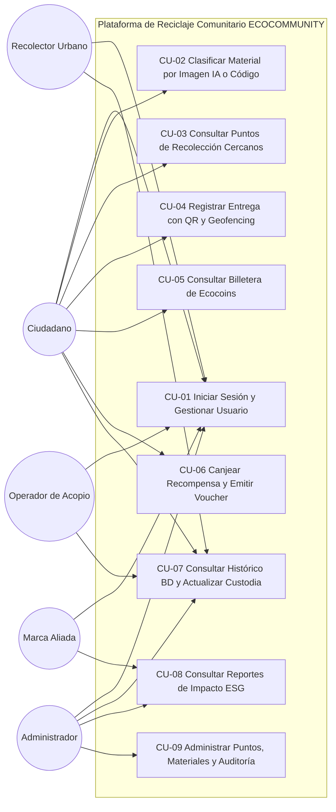
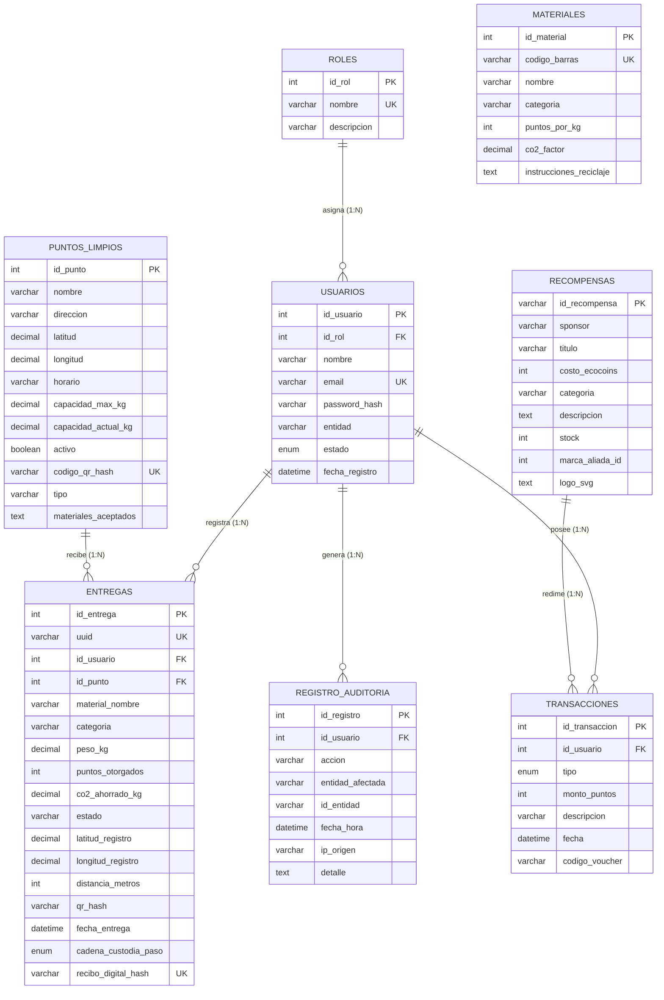
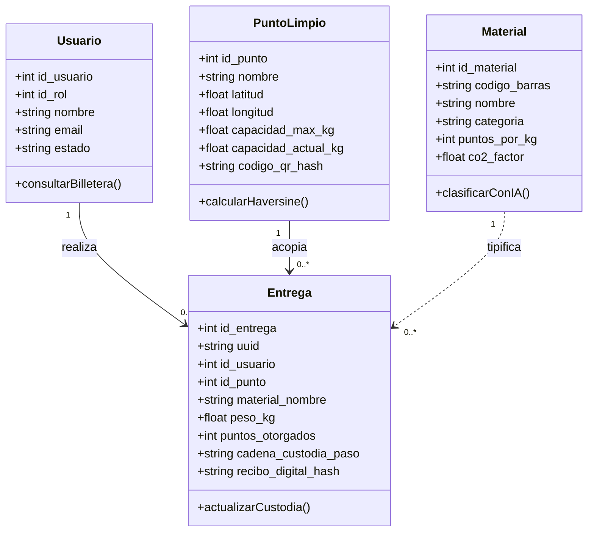

# SERVICIO NACIONAL DE APRENDIZAJE – SENA
### CENTRO DE LA INDUSTRIA, LA EMPRESA Y LOS SERVICIOS
#### TECNÓLOGO EN ANÁLISIS Y DESARROLLO DE SOFTWARE (ADSO)

---

## CASOS DE USO (UC), DIAGRAMAS UML Y MODELO ENTIDAD-RELACIÓN (MER)
### PROYECTO #18: PLATAFORMA DE RECICLAJE COMUNITARIO
# **ECOCOMMUNITY**

**Módulos:** Usuarios · Materiales · Puntos de Recolección · Entregas  
**IA:** Clasificación orientativa de materiales mediante imágenes (Google Gemini AI)  
**Tecnología:** Python / Flask / MySQL (XAMPP + Liquibase)

---

**Presentado por (Aprendiz):**  
**PAULA VALENTINA VARGAS ANDRADE**

**Presentado a (Instructor Técnico):**  
**JAVIER UMBERTO PINTO**

**Centro de Formación:**  
SENA – Centro de la Industria, la Empresa y los Servicios

**Fecha:** Noviembre de 2026

---

## 1. Diagrama UML de Casos de Uso

---

## 2. Catálogo Resumido de Casos de Uso (`CU-01` a `CU-09`)

| Código | Nombre del Caso de Uso | Actor Principal | Módulo Proyecto #18 | Endpoint Python / Flask Asociado |
| :--- | :--- | :--- | :--- | :--- |
| **CU-01** | Iniciar Sesión ySeleccionar Rol | Todos los actores | Módulo Usuarios | `AuthModal` / Tabla `usuarios` |
| **CU-02** | Clasificar Material Reciclable por Imagen con IA o Código de Barras | Ciudadano | Módulo Materiales + IA | `POST /api/ai/classify` |
| **CU-03** | Consultar Puntos de Recolección y Cercanía GPS (Haversine) | Ciudadano | Módulo Puntos | `GET /api/puntos` |
| **CU-04** | Registrar Entrega Física con Validación QR y Geofencing $\le 20$ m | Ciudadano | Módulo Entregas | `POST /api/entregas/validate-and-deposit` |
| **CU-05** | Consultar Billetera de Ecocoins y Estadísticas de Impacto | Ciudadano | Módulo Usuarios / Billetera | `GET /api/user/wallet` |
| **CU-06** | Canjear Recompensa y Generar Voucher Digital | Ciudadano | Módulo Billetera | `POST /api/rewards/redeem` |
| **CU-07** | Consultar Histórico Interactivo en MySQL y Actualizar Cadena de Custodia | Operador / Ciudadano | Módulo Entregas / BD | `GET /api/entregas/history` y `PUT /api/entregas/<id>/custodia` |
| **CU-08** | Consultar Métricas Consolidadas de Sostenibilidad ESG | Marca / Admin / Ciudadano | Módulo Entregas / ESG | `GET /api/esg/report` |
| **CU-09** | Monitorear Estado de Base de Datos, Capacidad de Puntos y Auditoría | Administrador | Módulo Administración | `GET /api/db/status` |

---

## 3. Diagrama Modelo Entidad-Relación (MER — MySQL `ecocommunity_db`)

---

## 4. Diagrama UML de Clases

